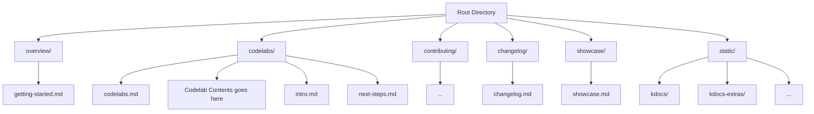

# Website

This website is built using [Docusaurus](https://docusaurus.io/), a modern static website generator.

## Installation

```bash
npm i
```

## Local Development

```bash
npm start
```

This command starts a local development server and opens up a browser window. Most changes are reflected live without having to restart the server.

## Build

```bash
npm run build
```

This command generates static content into the `build` directory and can be served using any static contents hosting service.

## Architecture




## Ask AI Widget

The site includes an AI chat widget ("Ask AI") that lets developers ask questions about Multipaz and get answers grounded in the official documentation.

### Architecture

```
┌──────────────────────────────────┐
│  Docusaurus Site (Frontend)      │
│                                  │
│  src/components/AskAIWidget.js   │
│  └─ Chat UI, streams responses   │
│     via Server-Sent Events       │
│                                  │
│  src/theme/Root.js               │
│  └─ Mounts widget on every page  │
└──────────────┬───────────────────┘
               │ POST /api/chat
               ▼
┌──────────────────────────────────┐
│  Vercel Serverless (api/)        │
│                                  │
│  api/chat.js                     │
│  └─ Gemini 2.5 Flash            │
│     + full docs as system prompt │
│                                  │
│  docs-context.txt (bundled)      │
│  └─ Built by build-docs-context  │
└──────────────────────────────────┘
```

See [api/README.md](api/README.md) for API setup, environment variables, and endpoint documentation.

### How the docs context is built

`api/build-docs-context.js` produces `api/docs-context.txt`, which is the knowledge base sent to Gemini as a system prompt. It aggregates content from two sources:

**Local directories** (from this repo):
| Directory | Content |
|---|---|
| `docs/` | SDK guides (getting started, issuer, verifier, etc.) |
| `codelabs/` | Step-by-step codelab tutorials |
| `contributing/` | Contribution guidelines |
| `blog/` | Blog posts |

**Remote files** (fetched from [openwallet-foundation/multipaz](https://github.com/openwallet-foundation/multipaz) at build time):
| File | Content |
|---|---|
| `README.md` | Library overview and module descriptions |
| `CHANGELOG.md` | Release notes and API changes |
| `DEVELOPER-ENVIRONMENT.md` | Dev setup instructions |
| `TESTING.md` | Test commands and procedures |
| `CODING-STYLE.md` | Kotlin coding conventions |
| `CONTRIBUTING.md` | PR and code review guidelines |
| `multipaz-cbor-rpc/RPC.md` | RPC system architecture |
| `multipaz-cbor-rpc/README.md` | CBOR serialization details |
| `multipaz-server-deployment/README.md` | Docker/Podman deployment guide |

### Rebuilding the docs context

After adding or modifying documentation in any of the sources above, rebuild the context file:

```bash
cd api
npm run build-context
```

This fetches the latest remote files and re-aggregates everything into `docs-context.txt`. The file is bundled into the Vercel serverless function at deploy time via `vercel.json`.

### Adding new documentation sources

To include a new **local directory**, add it to the `DOCS_DIRS` array in `api/build-docs-context.js`.

To include a new **file from the multipaz repo**, add its path to the `MULTIPAZ_REPO_FILES` array in the same file.

### Environment variables

**API server** (set in Vercel):
| Variable | Description |
|---|---|
| `GEMINI_API_KEY` | Google Gemini API key |
| `ALLOWED_ORIGINS` | Comma-separated list of allowed CORS origins |
| `RATE_LIMIT_PER_MIN` | Max requests per IP per minute (default: 10) |
| `DAILY_REQUEST_LIMIT` | Max total requests per day across all users (default: 300) |

**Docusaurus build** (set as [GitHub repo variables](https://docs.github.com/en/actions/writing-workflows/choosing-what-your-workflow-does/store-information-in-variables#creating-configuration-variables-for-a-repository) under Settings → Secrets and variables → Actions → Variables):
| Variable | Description |
|---|---|
| `ASK_AI_API_URL` | URL of the deployed Ask AI API (e.g., your Vercel deployment URL) |
| `WEBSITE_ENVIRONMENT` | `PRODUCTION` to serve at `/` (custom domain), `DEVELOPMENT` to serve at `/{repo-name}/` |
| `BUILD_KDOCS` | Set to `false` to skip API reference KDoc generation for faster builds (see [Skipping KDoc Generation](#skipping-kdoc-generation-faster-builds)). Optional; defaults to building KDocs |

### Deploying the API server to Vercel

```bash
cd api
npm install
npm run build-context   # rebuild docs-context.txt
vercel --prod           # deploy to production
```

On first deploy, Vercel will prompt you to link the project. After that, subsequent deploys with `vercel --prod` will update the production deployment.

## CI Config

### Overview
This project uses three repositories with automated documentation integration:

- **[Multipaz repository](https://github.com/openwallet-foundation/multipaz)**: Core Kotlin source code and KDocs
- **[Multipaz Extras repository](https://github.com/openwallet-foundation/multipaz-extras)**: Additional Kotlin libraries and KDocs
- **Docusaurus repository**: Documentation site that displays the generated API docs (this repo)

The workflow checks out both Kotlin repositories, runs `./gradlew dokkaGenerate`
for each (using a per-repository KDoc cache), and copies the output into the
Docusaurus static directories: Multipaz KDocs go to `static/kdocs/`; Extras
KDocs go to `static/kdocs-extras/`.

```

┌─────────────────────┐     ┌──────────────────────┐
│  Kotlin Repository  │     │ Docusaurus Repository│
│                     │     │                      │
│  ┌───────────────┐  │     │  ┌───────────────┐   │
│  │  Source Code  │  │     │  │  Markdown     │   │
│  └───────┬───────┘  │     │  │  Documentation│   │
│          │          │     │  └───────────────┘   │
│  ┌───────▼───────┐  │     │                      │
│  │  Dokka Tool   │  │     │  ┌───────────────┐   │
│  └───────┬───────┘  │     │  │  Static Dir   │   │
│          │          │     │  │  ┌─────────┐  │   │
│  ┌───────▼───────┐  │     │  │  │ /api/   │◄─┼───┘
│  │ Generated     │  │     │  │  └─────────┘  │   │
│  │ API Docs      │──┼─────┼─►│               │   │
│  └───────────────┘  │     │  └───────────────┘   │
└─────────────────────┘     └──────────────────────┘

```

### Automation Workflow
[Multipaz or Extras Code Changes] → [Trigger Action] → [Build both KDocs] → [Copy to Docusaurus] → [Deploy Site]

GitHub Actions Setup

1. In Multipaz Repository => [.github/workflows/trigger-docusaurus-update.yml](https://github.com/openwallet-foundation/multipaz/blob/main/.github/workflows/trigger-docusaurus-update.yml) triggers `kotlin-repo-updated` whenever there's an update.
2. In Multipaz Extras Repository => [.github/workflows/trigger-docusaurus-update.yml](https://github.com/openwallet-foundation/multipaz-extras/blob/main/.github/workflows/trigger-docusaurus-update.yml) triggers `extras-repo-updated` whenever there's an update.
3. In Multipaz Developer Website Repository => [.github/workflows/docs.yml](https://github.com/openwallet-foundation/multipaz-developer-website/blob/main/.github/workflows/docs.yml). It responds to both `kotlin-repo-updated` and `extras-repo-updated`, generates KDocs for both repositories, and publishes them at `/kdocs` and `/kdocs-extras` respectively.

### Skipping KDoc Generation (faster builds)

Generating the API reference KDocs (`./gradlew dokkaGenerate` for both the
`multipaz` and `multipaz-extras` repos) is by far the slowest part of the build.
The `BUILD_KDOCS` flag lets you skip it — useful for forks and quick test
deployments that don't need the API reference. When skipped, the site still
builds and deploys; only the `/kdocs` and `/kdocs-extras` API reference pages are
omitted (links into them will 404 on that deployment).

There are two ways to control it:

| How | Scope | Effect |
|---|---|---|
| **`build_kdocs` checkbox** on the manual *Run workflow* dialog (Actions → Build and Deploy Docusaurus with KDocs → Run workflow) | A single manual run | Tick to build, untick to skip. **Overrides the repository variable.** |
| **`BUILD_KDOCS` repository variable** (Settings → Secrets and variables → Actions → **Variables** → New repository variable) | All automatic runs (push / `repository_dispatch`) | Set to `false` to permanently skip KDoc generation. Any other value (or unset) builds them. |

`BUILD_KDOCS` is a repository **variable**, not a secret — no secret needs to be
configured for this. The checkbox is authoritative on manual runs; the variable
only governs automatic runs.

### Required Repository Settings

To enable automatic documentation updates between repositories, you need to set up a Personal Access Token (PAT).

#### Step 1: Generate Personal Access Token

1. **Go to GitHub Settings**: Navigate to [https://github.com/settings/personal-access-tokens/new](https://github.com/settings/personal-access-tokens/new)
2. **Select Token Type**: Choose "Fine-grained personal access tokens"
3. **Configure Token Settings**:
   - **Token name**: `DOCS_REPO_ACCESS_TOKEN`
   - **Description**: `Token for automated documentation updates between multipaz and developer website repo`
   - **Expiration**: `366 days` (or your preferred duration)
4. **Set Repository Access**:
   - **Resource Owner**: `openwallet-foundation`
   - **Repository access**: `Selected repositories`
   - **Select repository**: `openwallet-foundation/multipaz-developer-website`
5. **Set Permissions**:
   - **Content**: `Read and write`
   - **Metadata**: `Read`
6. **Generate Token**: Click "Generate token" and **copy the token immediately** (it won't be shown again)

#### Step 2: Add Token as Repository Secrets

1. **Multipaz Repository**: Navigate to [https://github.com/openwallet-foundation/multipaz/settings/secrets/actions](https://github.com/openwallet-foundation/multipaz/settings/secrets/actions)
2. **Extras Repository**: Navigate to [https://github.com/openwallet-foundation/multipaz-extras/settings/secrets/actions](https://github.com/openwallet-foundation/multipaz-extras/settings/secrets/actions)
2. **Add New Secret**:
   - Click "New repository secret"
   - **Name**: `DOCS_REPO_ACCESS_TOKEN`
   - **Secret**: Paste the token you generated in Step 1
   - Click "Add secret"

#### What This Enables

This setup allows the Multipaz and Multipaz Extras documentation-update workflows to automatically update the developer website whenever either repository changes. Configure the same `DOCS_REPO_ACCESS_TOKEN` secret in both source repositories.

## GitHub Pages Setup

Docusaurus can run in two modes depending on your deployment setup:

### Option 1: Custom Domain (PRODUCTION mode)
For custom domains like `developer.multipaz.org`:

1. **Enable GitHub Pages**: In Docusaurus repo, go to **Settings → Pages** and enable GitHub Pages with GitHub Actions as source
2. **Set Custom Domain**: Under **Custom domain**, enter:  
   ```
   developer.multipaz.org
   ```  
3. **Save Changes**: Click save to apply the custom domain
4. **Verify DNS**: Optionally, verify that DNS settings (CNAME or A records) are set properly for `developer.multipaz.org` pointing to GitHub Pages
5. **Set Environment Variable**: Configure `WEBSITE_ENVIRONMENT` GitHub repository variable as `PRODUCTION`

### Option 2: GitHub Pages Subdomain (DEVELOPMENT mode)
For github.io pages like `openwallet-foundation.github.io/multipaz-developer-website`:

1. **Enable GitHub Pages**: In Docusaurus repo, go to **Settings → Pages** and enable GitHub Pages with GitHub Actions as source
2. **Set Environment Variable**: Configure `WEBSITE_ENVIRONMENT` GitHub repository variable as `DEVELOPMENT`
3. **No Custom Domain**: Leave the custom domain field empty

### Deployment
After configuration:
- Trigger the [`Build and Deploy Docusaurus with KDocs`](https://github.com/openmobilehub/developer-multipaz-website/actions/workflows/docs.yml) workflow
- The `baseUrl` will automatically be set to:
  - `/` for custom domains (PRODUCTION mode)
  - `/{repository_name}` for github.io pages (DEVELOPMENT mode)

### Reference
See GitHub's guide for more details: [Configuring a custom domain for your GitHub Pages site](https://docs.github.com/en/pages/configuring-a-custom-domain-for-your-github-pages-site)

## CI Monitoring

The GitHub Actions workflows we maintain across the multipaz repos are monitored
continuously by a scheduled workflow in this repo. It polls the recent runs of each
watched workflow via the GitHub API and comments on the
["CI alerts" tracking issue](https://github.com/openwallet-foundation/multipaz-developer-website/issues/118)
when a workflow starts failing, @mentioning the owners, and posts a recovery comment
when it passes again.

This exists because built-in GitHub notifications only fire for the user who triggered
a run, leaving scheduled, push, and bot-triggered failures silent. Past incidents sat
unnoticed for days (e.g. Trigger Docs Update failing 12 runs in a row). This replaces
manual per-repo notifications. The options considered were per-repo workflows, a
dead-man's-switch service, and relying on GitHub's built-in notifications (which only
notify the run's actor); the scheduled single-workflow design was the smallest one
covering scheduled, push, and bot-triggered failures.

### How it works

| Piece | Location | Role |
|---|---|---|
| Watch list | `monitor.json` (repo root) | Repos and workflow files to watch, plus optional filters |
| Monitor workflow | `.github/workflows/monitor.yml` | Hourly poll (minute 17), monthly heartbeat, posts alerts |
| Tracking issue | ["CI alerts"](https://github.com/openwallet-foundation/multipaz-developer-website/issues/118) | Where alerts land; also the monitor's state store |

**What counts as failing.** All non-PR runs on any branch count. A run whose
conclusion is `failure`, `timed_out`, or `startup_failure` is failing; `cancelled` and
`skipped` runs are ignored. By default a *whole-workflow* failure alerts — the
optional `steps` filter narrows that to the part we maintain (see below).

**Alerting model.** The monitor compares each workflow's latest completed run with
that workflow's current alert state and posts:

| Alert | Meaning |
|---|---|
| ❌ *started failing* | The run failed, and the `steps` filter (if any) matched |
| ✅ *is passing again* | Posted only when a run concludes `success` after a ❌ |
| ⚠️ *workflow file not found* | File renamed/deleted in the watched repo — or Actions disabled, e.g. on a fork |
| ⚠️ *watched step(s) not found* | A `steps` filter no longer matches — update `monitor.json` |
| 💚 *monitor is alive* | Monthly heartbeat (also posted on manual dispatch) proving the monitor itself runs |

On a **filtered** entry, a failed run where the watched step did not fail (for
example a sentinel step that was skipped because an earlier step failed) is treated
as *unknown*: the monitor neither alerts nor posts a recovery, and recovery is only
ever declared from an actual successful run in which the watched step is present.
A missing watched step produces the ⚠️ warning instead of a recovery.

State and dedupe live in hidden markers (`<!-- down:... -->` / `<!-- up:... -->`)
inside comments authored by `github-actions[bot]` — **do not delete those comments**,
or the same failure re-alerts.

### Adding a workflow to the watch list

Onboarding a repo is one line in `monitor.json` — no change to the watched repo:

```json
{ "file": "deploy.yml", "label": "Deploy to production" }
```

- `file` — the workflow **file name** in the watched repo, e.g. `deploy.yml`
- `label` — a human-readable name used in alerts

A failure of that whole workflow alerts by default. To watch only part of a workflow,
add a `steps` filter:

```json
{ "file": "unit-test.yml", "label": "Run Unit Tests", "steps": ["Fail if Detekt failed"] }
```

- `steps` — alert only if one of these **step names** fails

`steps` matches the `name:` values in the watched workflow file — the step names its
Actions page lists for a run. It is optional; with no `steps` filter, any failure of
the workflow alerts.

Alerts go to the handles in `MENTION` at the top of `monitor.yml`. A repo entry can
override that with its own `mention`, e.g.
`{ "repo": "org/repo", "mention": "@owner-a @owner-b", "workflows": [ ... ] }`.

### The detekt-only case

For [multipaz](https://github.com/openwallet-foundation/multipaz)'s *Run Unit Tests*
workflow we only maintain detekt (the KDoc-coverage check), not the unit tests.
Detekt runs as a step with `continue-on-error: true` (so its API conclusion is
unreliable), and the workflow converts a detekt failure into a hard failure via a
sentinel step. We watch the sentinel:

```json
{ "file": "unit-test.yml", "label": "Run Unit Tests (detekt only)", "steps": ["Fail if Detekt failed"] }
```

The sentinel is skipped whenever an earlier step fails, so on a red build a detekt
failure is masked; the monitor then has nothing to alert on and treats the run as
*unknown* (it never posts a recovery for it). A one-line change to the sentinel's
condition in multipaz — `if: ${{ !cancelled() && steps.detekt.outcome == 'failure' }}`
— makes it run even when an earlier step failed; until that lands, a detekt problem on
an otherwise red `main` can go unseen.

### Operating it

- **First-time setup:** create the "CI alerts" issue, then set its number in `ISSUE`
  and the default handles in `MENTION` in `monitor.yml`.
- **Manual run:** Actions → *Monitor workflows* → *Run workflow*
  (`workflow_dispatch`). It also posts the heartbeat, so it can be exercised by hand.
- **Renames:** workflow files are matched by file name, so a rename triggers a
  `not found` alert until `monitor.json` is updated.

### Limitations

- **Latency:** alerts can lag up to ~1 hour (hourly cron), and GitHub executes
  scheduled cron runs on a best-effort basis — they can be delayed or skipped.
- **Masked detekt failures:** see [the detekt case](#the-detekt-only-case) — on a red
  build the sentinel step is skipped, so a detekt failure may not alert until that
  multipaz condition change lands.
- **Comments as a database:** dedupe uses bot-authored comments; deleting or editing
  them can cause repeat alerts.
- **Name coupling:** workflows and filters match by name; renames need a
  `monitor.json` update (the monitor warns with a `not found` alert).
- **No automatic monitor-of-the-monitor:** if this workflow stops running, alerts stop
  silently — the monthly heartbeat only helps if someone notices it is missing. GitHub
  also disables scheduled workflows after 60 days without repository activity, so the
  schedule depends on this repo staying active. Revisit ownership during any LFDT
  migration.